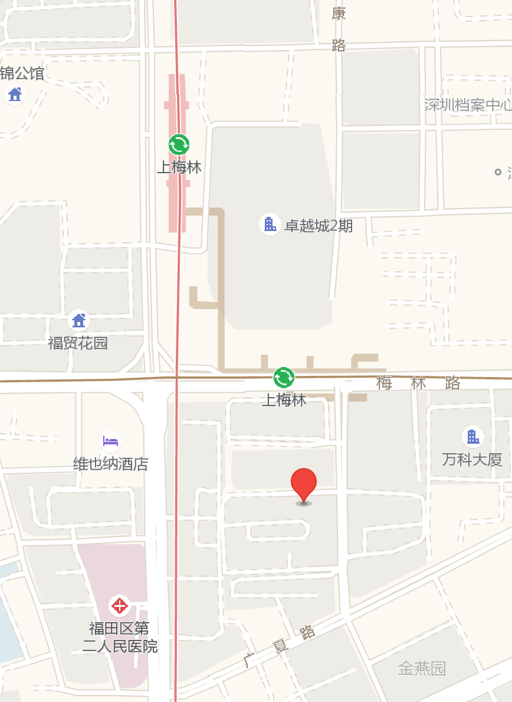
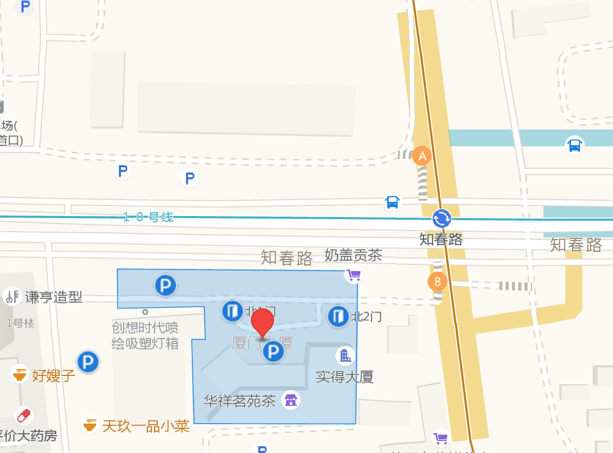

# Please visit and subscribe to HelloGCC.org

HelloLLVM.org is used for meetup announcements of our OSDT community. Since 2019, the HelloLLVM community and the OSDT community (formerly the HelloGCC community) have been merged.

The annual OSDT conference is announced on HelloGCC.org.

https://hellogcc.org

https://github.com/hellogcc

# 13th Open Source Development Tools Conference: CFP is open!

https://github.com/hellogcc/hellogcc.github.io/blob/main/blog/2021-10-19-CFP-OSDT-Conf-2021.md

# OSDT community October meetup: impact of the open sourced XuanTie C910 on the RISC-V community, Chisel progress and more

https://github.com/hellogcc/osdt-weekly/blob/master/events/2021-10-24-OSDT-Meetup.md

# OSDT Monthly Meetup 2021-02-21

This one is again online.

This is a virtual meetup. Let's talk in the Zoom Meeting Room.

## Time

LOS ANGELES, United States, California
6:00p	Sat, Feb 20 2021
8:00p	Sat, Feb 20 2021

BEIJING, China
10:00a	Sun, Feb 21 2021
12:00p	Sun, Feb 21 2021

LONDON, United Kingdom, England
2:00a	Sun, Feb 21 2021
4:00a	Sun, Feb 21 2021

## Agenda

- MaskRay: Recent Works about TLS, and others.
- RadarSong: Hands up on Debugging TVM using VSCode
- Hongbin Zhang: Recent Works on MLIR
- Open Discussion

## Live Streaming

https://live.bilibili.com/10339607

No registration needed — just watch. If you have a Bilibili account, log in to ask questions via danmaku.

No login needed. you can view it directly.

## Join the Zoom Meeting!

Wei Wu - PLCT Lab is inviting you to a scheduled Zoom meeting.

Topic: OSDT Monthly Meetup Feb-2021

Time: Feb 21, 2021 10:00 AM Beijing, Shanghai

Join Zoom Meeting

https://zoom.com.cn/j/89465142537?pwd=YVA2MEhuSXJQd2pFM2lCa0xoRVdFdz09

Meeting ID: 894 6514 2537

Passcode: 555049

## Call for Speakers/Talkers

Talks are welcome. Please send your talk information to Wei Wu. Email: lazyparser at gmail dot com.

# OSDT Monthly Meetup 2021-01-24

This month's meetup is online. We are currently soliciting talks.

Video replay: https://www.bilibili.com/video/BV1fA411H7sW

## Time and Venue

- Sunday, January 24, 2021, 09:30 - 12:00 Beijing time
- Saturday, January 23, 2021, 17:30 - 20:00 PST/PDT
- Venue: Zoom

## Agenda

- Wang Chen — AOSP for RISC-V at Alibaba T-Head: an open source analysis — can enthusiasts quickly adapt it to their own boards?
- MaskRay — regular recent-work sharing, or rescue archaeology of code
- Liao Chunyu — recent work on Clang/LLVM
- Li Weiwei — Introduction of the SAIL model (as much as time allows)
- Open discussion

## Live Streaming

https://live.bilibili.com/10339607

No registration needed — just watch. If you have a Bilibili account, log in to ask questions via danmaku.

## Join via Zoom

ISRC ISCAS is inviting you to a scheduled Zoom meeting.

Topic: OSDT Meetup 20210124

Time: Jan 24, 2021 10:00 AM Beijing, Shanghai

Join Zoom Meeting

Meeting ID: 813 4591 8148

Passcode: 732732

## Call for Speakers

Talks are welcome. Please send your talk information to Wei Wu. Email: lazyparser at gmail.com.

# The last OSDT meetup of 2020 — RISC-V, OpenJ9 — 2020-12-27

The last OSDT Meetup of 2020 will be held on Sunday morning, December 27. This time we have invited Cheng Jin to give a special introduction to the past, present and RISC-V-related future of OpenJ9. We also welcome community friends to sign up and share their own work. There are still three 30-minute talk slots available, as well as several lightning talk slots.

## Agenda (TBD, may be adjusted)

**Sunday, December 27, 2020, 10:00–12:00**

Full video replay: [The last OSDT meetup of 2020 — OpenJ9, Musl, RISC-V](https://www.bilibili.com/video/BV1t54y1t7JY)

- 09:50 - 10:00 Opening, self-introductions, etc.
- 10:00 - 11:00 Cheng Jin — OpenJ9 on RISC-V [video](https://www.bilibili.com/video/BV1Gy4y1U7wQ)
- 11:00 - 11:50 MaskRay — musl security features [video](https://www.bilibili.com/video/BV1H5411H78v)
- 11:50 - 12:00 Reserved talks / lightning talks: TBD, sign up welcome. (None)

## Live Streaming

(Permanent address, feel free to bookmark)

https://live.bilibili.com/10339607

No registration needed — just watch. Danmaku questions require login.

## Join the video meeting

TBD / Zoom meeting link. Later you can get it from the OSDT WeChat official account (ID: hellogcc2007), or request the meeting link via lazyparser at gmail dot com (put OSDT Zoom in the subject).

## Call for Speakers

Talks are welcome — please contact OSDT community lead Wei Wu to sign up, directly via WeChat or by leaving a message via lazyparser at gmail dot com.

# East Asia time zone RISC-V ecosystem biweekly sync confirmed + sharing session announcement

## First East Asia time zone RISC-V ecosystem biweekly sync

Hi everyone, last week's poll on the meeting time has concluded. The first sync meeting will be:

**Thursday, December 10, 2020, 15:00–16:00**

The meeting uses Tencent Meeting. Send the keyword "双周会" (biweekly) via the CNRV or OSDT WeChat official account to get the meeting info.

Depending on the talk content and participants' needs, we may switch to Zoom or another online format — please follow the CNRV WeChat official account for updates.

Continuing the RVI tradition, the biweekly sync is a working meeting. Anyone can join by video directly; no live stream and no recording (there is no need for either). Meeting minutes will be published afterwards.

At the same time, we are happy to have Kito Cheng from SiFive give a sharing session on Tuesday afternoon, December 8:

## Kito Cheng: Branch Management for RISC-V GNU Toolchain and Policy for Unratified Extensions

Abstract: At the monthly RVI SSC meeting in the early hours of December 5, Kito presented the current state of GNU toolchain management and the upcoming changes. In short, the current repo management under RVI's GitHub is too heavy a burden for maintainers and cannot keep up with the needs of combining and validating multiple extensions. After discussion with Jim Wilson and others, Kito proposed several options. After the SSC meeting a relatively clear consensus emerged, including gradually phasing out the GNU repositories managed by RVI itself.

This work has derivative effects — for example, it may break all current links in RISC-V toolchain documentation and tutorials. As for unratified extensions, this change may bring more participation and contribution opportunities to the attention of the East Asia community, and may help improve the RISC-V GNU toolchain.

Time: December 8, 14:00–15:00

How to join: Zoom meeting. Send "kito" via the CNRV WeChat official account to get the Zoom link.

## Background

The full document of the initiative is at:
https://github.com/isrc-cas/PLCT-Weekly/blob/master/RISCV-Biweekly-Sync-in-Chinese-Language.md

Brief:

Motivation:
1. Regularly summarize the meeting trends of the various technical committees of RVI. Since RVI meetings are always held in the middle of the night, middle-aged folks can't take it — we need energetic people to share.
2. Communicating in Chinese is more efficient.
3. Attract and mobilize more newcomers and enthusiasts in China to join the RISC-V ecosystem.

Meeting format:

Fully online. Tencent Meeting or Zoom. Once every two weeks.

Organizer:

Currently organized by Wei Wu (lazyparser) personally, with the support of the CNRV community.

Contact: Wei Wu wuwei2016 [at] iscas.ac.cn

# 12th Open Source Development Tools Conference (OSDT 2020)

The 12th Open Source Development Tools Conference (OSDT Conf, formerly HelloGCC Workshop) will be held online on December 5–6 (Saturday and Sunday). The conference will be coordinated with PLCT Lab's annual open day (PLCT OpenDay 2020).

The conference is the annual developer gathering organized by the OSDT community (formerly the HelloGCC community), where we share our open source development work, research results and lessons learned. Topics mainly target open source development tools, including GCC, Binutils, GDB, glibc, Clang/LLVM, QEMU, gem5, Chisel/FIRRTL, MLIR, TVM, CIRCT and more.

The conference will be coordinated with PLCT Lab's annual open day (PLCT OpenDay 2020). PLCT Lab — the Programming Languages and Compiler Technology Lab — belongs to the Intelligent Software Research Center (ISRC) of the Institute of Software, Chinese Academy of Sciences (ISCAS). Every December it holds an OpenDay event to show and introduce the fun technical experiments PLCT has done over the year, and the results we believe change the world in some corner. This is the second OpenDay held by PLCT — welcome to enjoy the fun of technical exchange together. (Due to the pandemic, please don't come on site this year — it's fully online.)

## Sponsor acknowledgements

- Thanks to Tsinghua University Press for sponsoring 10 copies of "Embedded System Design Based on FPGA and RISC-V" for the OSDT conference.
- Thanks to Publishing House of Electronics Industry for sponsoring 5 copies of "The Pragmatic Programmer (20th Anniversary Edition)" and 5 copies of "Practical Java Virtual Machine (2nd Edition)".
- Thanks to PerfXLab for sponsoring 2 sets of Perf-V FPGA 35T development boards and 1 set of Perf-GAP8 development board.
- Thanks to the Intelligent Software Research Center of the Institute of Software, CAS, for providing the venue and Zoom meeting rooms.

NOTE: the books and development boards were originally planned to be given to questioners on site and via lucky draw. However, due to the pandemic, after the conference moved online this year, how to distribute them effectively (for free) is still under discussion. Friends with similar experience are welcome to share suggestions and experience.

## Time

- Friday, December 4, 2020, 09:30 - 17:30 PLCT OpenDay 2020
- Saturday, December 5, 2020, 10:00 - 17:30 OSDT Conf 2020
- Sunday, December 6, 2020, 10:00 - 17:30 OSDT Conf 2020

## Venue / how to join

- Live stream: https://live.bilibili.com/10339607
- Tencent Meeting: access info after registration
- Zoom: the morning session on December 6 will be held via Zoom; access info after registration
- Registration: https://www.bagevent.com/event/7014036

## Schedule

### Friday, December 4, 2020
- 09:00-09:30	Device setup, etc.
- 09:30-10:00	Wei Wu: PLCT Lab Roadmap 2021
- 10:00-10:30	Ji Qiu: V8 for RISC-V: where it came from and where it is going
- 10:30-11:00	Xing Mingjie: RISC-V vector extension ISA and compiler support
- 11:00-11:30	Shi Ningning: Ark compiler and Android Runtime
- 11:30-12:00	Zhao Weifeng: A nine-story tower starts with a pile of earth — TenonStudio 2020 features
- 12:00-14:00	Break
- 14:00-14:30	Xu Zhongxing: Technical areas involved in TenonStudio
- 14:30-15:00	Wang Da: Introduction to the robot description language SDFormat
- 15:00-15:30	Zhang Hongbin: Building an end-to-end compilation flow with MLIR
- 15:30-16:00	Zhang Yin: OpenCV optimization based on RISC-V vector extensions
- 16:00-16:30	Liao Chunyu: Implementing RVV intrinsics in Clang
- 16:30-17:00	Chen Xiaoou: Introduction to the LLVM testing framework
- 17:00-17:30	(Reserved talk slot)

### Saturday, December 5, 2020
- 09:30-10:00	Device setup, etc.
- 10:00-10:30	Wu Zhangjin: Life is short, I use Linux Lab to learn kernels and embedded systems
- 10:30-11:00	Zhang Xianyi: Optimizing the basic computing software ecosystem with the RISC-V vector ISA
- 11:00-11:30	Yang Wenzhang: DeepLang — a programming language for IoT
- 11:30-12:00	Wang Chen: Building a minimal Android system on RISC-V
- 12:00-14:00	Break
- 14:00-14:30	An Longfei: Introduction to C++20 coroutines and applications
- 14:30-15:00	Chen Jiawei: Introduction to RISC-V Binutils
- 15:00-15:30	Lu Xufan: RISC-V vector objects on the stack and their LLVM implementation
- 15:30-16:00	Lu Yahan: Pointer compression in V8 and a source-level analysis of its implementation
- 16:00-16:30	Tao Liqiang: Source analysis of V8 register allocation — in the context of adding the RISCV-C extension
- 16:30-17:00	Qianli Bingfeng: Talk title TBD
- 17:00-17:30	Lightning talks (sign up in advance or on site)

### Sunday, December 6, 2020
- 09:30-10:00	Device setup, etc.
- 10:00-11:00	MaskRay: TBD
- 11:00-11:30	Ye Jinyun: Huawei and GCC/LLVM (attendance TBD)
- 11:30-12:00	Lightning talks
- 12:00-14:00	Break
- 14:00-14:30	Wang Meng: Progress on RT-Thread USB-Host on Raspberry Pi
- 14:30-15:00	Zhang Dingli
- 15:00-15:30	Wang Junqiang: Adding and implementing RISC-V SoCs in QEMU — the Nuclei SoC example
- 15:30-16:00	Li Weiwei: Introduction to Spike extension approaches
- 16:00-16:30	Guo Ren: TBD (attendance TBD)
- 16:30-17:00	sequencer: TBD
- 17:00-17:30	Lightning talks

## Talk abstracts

**Wei Wu: PLCT Lab Roadmap 2021**

A review of PLCT Lab's work in 2020 and planning for 2021.

Wei Wu is project director of PLCT Lab.

**Ji Qiu: V8 for RISC-V: where it came from and where it is going**

The history, current status and future plans of V8 for RISC-V.

Dr. Ji Qiu leads the V8 for RISC-V project in the VM group of PLCT Lab.

**Xing Mingjie: RISC-V vector extension ISA and compiler support**

An introduction to the RISC-V vector extension ISA and how compilers support it.

Xing Mingjie is a senior engineer at the Institute of Software, CAS, with research focus on compiler technology.

**Shi Ningning: Ark compiler and Android Runtime**

More than a year after the Ark compiler went open source, the marketing heat has passed; what remains are industry peers who genuinely care about compiler development. How far has the Ark compiler come, what problems does it face, in which directions might it evolve, and what is the relationship between the Ark compiler and ART — all of these are of interest to peers. This talk attempts to share on these topics and summarizes the work PLCT has done in the Ark compiler community.

Shi Ningning is a project lead at PLCT Lab, ISCAS, and an active contributor to open source communities including OSDT and the Ark compiler. His blog series "LLVM Daily" and "Ark Compiler Study Notes" have been widely read. In September 2020 he published "The Beauty of Huawei Ark Compiler — Architecture Analysis and Implementation Based on Open Source Code", the first book on the Ark compiler community.

**Zhao Weifeng: A nine-story tower starts with a pile of earth — TenonStudio 2020 features**

An introduction to the features of TenonStudio 2020.

Zhao Weifeng is a member of the TENON project group at ISRC, ISCAS.

**Xu Zhongxing: Technical areas involved in TenonStudio**

A preliminary introduction to the technical areas involved in TenonStudio, including an overview, references, open source systems, and personal development experience.

Xu Zhongxing leads the TENON project group at ISRC, ISCAS.

**Wang Da: Introduction to the robot description language SDFormat**

Talk abstract: omitted.

Wang Da is a member of the TENON project group at ISRC, ISCAS.

**Zhang Hongbin: Building an end-to-end compilation flow with MLIR**

A simple example of using MLIR to build a compilation path from a computation graph to X86/RISC-V platforms.

Speaker bio:
Student at PLCT Lab, ISRC, ISCAS
MLIR community contributor (MLIR Python Bindings)
Zhihu / Bilibili — Fasthouse (法斯特豪斯)

**Zhang Yin: OpenCV optimization based on RISC-V vector extensions**

OpenCV provides an internal generic vector system called Wide Universal Intrinsics. It offers a unified interface to frontend programmers; at compile time these interfaces are lowered to SIMD/vector instructions supported by the current platform. This project implements support for the RISC-V ISA and its "V" vector extension (RVV) for Wide Universal Intrinsics, enabling vector acceleration for OpenCV on RISC-V.

Zhang Yin is a master's student at PLCT Lab.

**Liao Chunyu: Implementing RVV intrinsics in Clang**

Liao Chunyu is a compiler engineer on the RVV-LLVM project in the compiler group of PLCT Lab.

**Chen Xiaoou: Introduction to the LLVM testing framework**

Chen Xiaoou is a test development engineer at PLCT Lab.

### Saturday, December 5, 2020

**Wu Zhangjin: Life is short, I use Linux Lab to learn kernels and embedded systems**

The project author personally reveals Linux Lab, one of the most popular domestic open source projects of 2020, and shows you a more efficient and economical way to learn and develop the Linux kernel and embedded Linux systems.

Wu Zhangjin is the author of Linux Lab, MIPS Ftrace and other open source projects, a contributor to the official Linux community, and the founder of the well-known Chinese Linux technology community Tinylab.

**Zhang Xianyi: Optimizing the basic computing software ecosystem with the RISC-V vector ISA**

Abstract: With the development of the RISC-V Vector ISA, basic computing libraries and frameworks need targeted optimization to exploit the high performance of vector instructions. This report introduces our progress on optimizing the open source matrix computing library OpenBLAS and the computer vision library OpenCV for RISC-V Vector.

Dr. Zhang Xianyi received his bachelor's and master's degrees from Beijing Institute of Technology and his PhD from the University of Chinese Academy of Sciences, followed by postdoctoral research at UT Austin and MIT. He is the founder and main maintainer of the internationally known open source matrix computing project OpenBLAS. In 2016 he founded PerfXLab, providing intelligent edge computing solutions and software ecosystems and computing platforms for domestic chips.

**Yang Wenzhang: DeepLang — a programming language for IoT**

Huawei's programming language lab mentors an open source programming language called DeepLang. Everything in DeepLang's design is open source, including the spec, compiler and VM.

The DeepLang open source development team is made up of students from Zhejiang University, USTC and Imperial College.

Slides: http://deeplang.org/assets/files/%E9%9D%A2%E5%90%91IoT%E7%9A%84%E7%A8%8B%E5%BA%8F%E8%AE%BE%E8%AE%A1%E8%AF%AD%E8%A8%80-deeplang.pdf

DeepLang website: www.deeplang.org

DeepLang repository: https://github.com/deeplang-org/deeplang

Yang Wenzhang is a member of the DeepLang development team and a student at USTC.

**Wang Chen: Building a minimal Android system on RISC-V**

How to build a minimal system for Android on the RISC-V platform, with related background and technical introduction.

Wang Chen leads the AOSP for RISC-V project group at PLCT Lab.

**An Longfei: Introduction to C++20 coroutines and applications**

This report introduces the basic concepts of coroutines, how to use C++20 coroutines, the state of C++20 coroutine libraries, and their application at Alibaba.

An Longfei is an engineer at Alibaba.

**Chen Jiawei: Introduction to RISC-V Binutils**

The RISC-V binutils tool framework, usage of tools such as as and ld, and support for RISC-V (more TBD).

Chen Jiawei is a GNU toolchain engineer in the compiler group of PLCT Lab.

**Lu Xufan: RISC-V vector objects on the stack and their LLVM implementation**

Lu Xufan is an LV4 intern on the RVV-LLVM project in the compiler group of PLCT Lab.

**Lu Yahan: Pointer compression in V8 and a source-level analysis of its implementation**

Lu Yahan is an engineer in the V8 project group of the VM branch of PLCT Lab.

**Tao Liqiang: Source analysis of V8 register allocation — in the context of adding the RISCV-C extension**

Tao Liqiang is an LV3 intern in the V8 project group of the VM branch of PLCT Lab.

**Qianli Bingfeng: Talk title TBD**

TBD

**Lightning talks**

Sign up in advance or on site.

### Sunday, December 6, 2020

**MaskRay: Talk title TBD**

TBD

**Ye Jinyun: Huawei and GCC/LLVM (attendance TBD)**

Huawei continues to invest in GCC and LLVM, contributing a large amount of code to the community, and recently released Huawei GCC and an LLVM-based compiler to support Huawei's general-purpose computing platforms. I hope to summarize Huawei's work and plans on open source compilers with concrete examples.

Ye Jinyun is a technical expert at Huawei's compiler department.

**Ma Jun: Clang/LLVM development and deployment at Alibaba (lightning)**

TBD

**Wang Meng: Progress on RT-Thread USB-Host on Raspberry Pi**

Wang Meng is an LV4 intern in the emulator group of PLCT Lab.

**Zhang Dingli: Introduction to Java on RISC-V and BiSheng JDK testing on HiFive Unleashed**

Zhang Dingli:
1. Introduce current Java-on-RISC-V support;
2. Introduce BiSheng JDK for RV64 and its debugging method on HiFive Unleashed;
3. Analyze the crash of BiSheng JDK for RV64 from QEMU to HiFive Unleashed after open sourcing, and the corresponding first patch;
4. Share benchmark results of SPECjvm2008 and DaCapo-9.12-bach-MR1.

Zhang Dingli is a member of the OpenJDK for RISC-V project group in the VM branch of PLCT Lab.

**Wang Junqiang: Adding and implementing RISC-V SoCs in QEMU — the Nuclei SoC example**

How to add a Nuclei SoC under the existing RISC-V architecture in QEMU: the principles and implementation of new instructions, CSR, ECLIC, timer, UART and more, and how to compose gd32vf103 and the hummingbird board to run bare-metal programs and Linux.

Wang Junqiang leads the QEMU project in the emulator group of PLCT Lab.

**Li Weiwei: Introduction to Spike extension approaches**

Based on work we have completed and work in progress, an introduction to extension approaches for Spike (instructions, devices and memory access methods).

Li Weiwei leads the Spike project in the emulator group of PLCT Lab.

**Guo Ren: TBD (attendance TBD)**

TBD

**sequencer: TBD**

TBD

**Lightning talks**

Sign up in advance or on site.

### Past conferences
* OSDT 2019: https://github.com/hellogcc/OSDT2019
* OSDT 2018: https://github.com/hellogcc/OSDT2018
* OSDT 2017: https://github.com/hellogcc/OSDT2017
* OSDT 2016: http://www.hellogcc.org/?p=34295
* OSDT 2015: http://www.hellogcc.org/?p=34190
* OSDT 2014: http://www.hellogcc.org/?p=33910
* HelloGCC 2013: http://www.hellogcc.org/?p=33518
* HelloGCC 2012: http://linux.chinaunix.net/hellogcc2012
* HelloGCC 2011: http://linux.chinaunix.net/hellogcc2011
* HelloGCC 2010: http://linux.chinaunix.net/hellogcc2010
* HelloGCC 2009: https://sites.google.com/site/hellogccworkshop/hui-yi-ri-cheng

### Follow the WeChat official account for conference updates

WeChat official account: hellogcc2007

# OSDT Monthly Meetup 2020-11-22

This month's meetup is online.

Video replay:
https://www.bilibili.com/video/BV1A54y1k7q3

## Time and Venue

- Sunday, November 22, 2020, 10:00 - 11:30 (Beijing time)
- Saturday, November 21, 2020, 18:00 - 19:30 PST/PDT
- Venue: Zoom

## Agenda

- Chen Jiawei — "Implementing the RISC-V Zfinx extension in the GNU toolchain: a progress report"
- MaskRay — TBD (recent work)
- Free discussion

## Live Streaming

https://live.bilibili.com/10339607

No registration needed — just watch. If you have a Bilibili account, log in to ask questions via danmaku.

## Join via Zoom

Contact OSDT community lead Wei Wu to sign up (mark 【OSDT】 when adding on WeChat) or leave a message via lazyparser at gmail.com.

## Call for Speakers

Talks are welcome — please contact OSDT community lead Wei Wu to sign up (mark 【OSDT】 when adding on WeChat) or leave a message via lazyparser at gmail.com.

https://github.com/hellogcc/osdt-weekly/blob/master/images/hellogcc-wuwei.jpeg

# OSDT Hangzhou Meetup 2020-10-24

We are finally resuming offline meetups! This event is in Hangzhou, again around open source development tools, including secondary development based on GCC/LLVM/QEMU and other open source systems. RISC-V hardware and software enthusiasts and open source EDA practitioners are especially welcome to share their experience.

## Time and Venue

- Saturday, October 24, 2020, 14:00–17:00
- New Swan Meeting Room, 3F, Building 4, Eastern Communications Science Park, Dongxin Avenue, Binjiang District, Hangzhou (provisional — the address may change, please watch the WeChat official account)

## Agenda

(First half, with Bilibili live stream and recording)

- Wei Wu — Recent trends of the RISC-V Foundation and opportunities to get involved
- Shi Ningning — A brief analysis of ART OptimizingCompiler
- Li Weiwei — Experience learning QEMU/RISU and discussion
- Free discussion

(Second half, no live stream or recording — pure offline ranting)

- Chen Jiawei — I just started hacking on GCC and was assigned a RISC-V bug to fix next week, feeling nervous
- Wei Wu — The domestic open source environment is getting more and more restless and marketing-driven, and that's not good
- TBD — sign up on site
- Free discussion

**Wei Wu — Recent trends of the RISC-V Foundation and opportunities to get involved**

PLCT Lab has recently started attending the meetings of the various technical discussion groups (SIGs and TGs) of RISC-V International intensively and trying to participate. In this talk Wei Wu will share impressions of participating in these groups and the opportunities he currently sees for getting involved in RISC-V community work.

Wei Wu is project director of PLCT Lab and head of the OSDT community.

**Shi Ningning — A brief analysis of ART OptimizingCompiler**

OptimizingCompiler is an important part of ART and the concrete executor of AOT compilation in ART. At the same time, the main stages of the AOT compilation process have corresponding interfaces at the OptimizingCompiler level. Understanding OptimizingCompiler is very important for understanding ART as a whole. This sharing will briefly analyze the usage and implementation of OptimizingCompiler.

Shi Ningning is a project lead at PLCT Lab and an active contributor to the OSDT community.

**Li Weiwei — Experience learning QEMU/RISU and discussion**

Anyone working on QEMU? Let's chat!

Li Weiwei is a project lead at PLCT Lab and an active contributor to the OSDT community.

## Live Streaming (first half only)

https://live.bilibili.com/10339607

No registration needed — just watch. If you have a Bilibili account, log in to ask questions via danmaku.

## Join via Tencent Meeting

TBD

## Call for Speakers

Talks are welcome — please contact OSDT community lead Wei Wu to sign up (mark 【OSDT】 when adding on WeChat) or leave a message via lazyparser at gmail.com.

https://github.com/hellogcc/osdt-weekly/blob/master/images/hellogcc-wuwei.jpeg

# OSDT Online Technical Exchange Conference — CIRCT Special

Recently, the [CIRCT](https://github.com/llvm/circt) project led by Chris Lattner has been open sourced and handed over to the LLVM Foundation for hosting.
CIRCT means Circuit IR Compilers and Tools. You can see the motivation for the project from the repository README.
Our OSDT community is concerned that CIRCT may become part of the recent open source EDA movement, and it may combine with open source projects from organizations such as Google and lowRISC to create unlimited possibilities.
More short-term and direct is the question our members care about most: what kind of collisions will there be with Chisel/FIRRTL?

We will organize a special technical seminar on August 23 to conduct technical exchange and discussion around CIRCT and Chisel/FIRRTL. Welcome to sign up for a technical report or an opinion statement.

## Time

- 10:00 AM, August 23, 2020 (Shanghai, UTC+8)

## Program

- Zhang Hongbin — MLIR and its compilation flow and applications
- Han Boyang — Introduction to FIRRTL
- Free discussion

**Zhang Hongbin — MLIR and its compilation flow and applications**

Share the background of MLIR and its compilation process (MLIR Toy Tutorial), and share the application of MLIR in CIRCT.

The speaker Zhang Hongbin comes from the PLCT Laboratory of the Intelligent Software Research Center of the Software Institute of the Chinese Academy of Sciences. MLIR community participant and contributor.

**Han Boyang — Introduction to FIRRTL**

Share FIRRTL compiler installation, FIRRTL Spec introduction, FIRRTL compiler principle introduction.

The sharer Han Boyang comes from Xiamen University, and his main research direction is computer architecture security and EDA tools.

## Live watch

(Permanent address, bookmarkable)

https://live.bilibili.com/10339607

No registration is required, just watch it. You need to log in to ask questions.

## Video conference participation

Conference theme: OSDT seminar CIRCT theme

Meeting time: 2020/8/23 10:00-12:00

Click the link to join the conference, or add to the conference list:
https://meeting.tencent.com/s/HyoQXKb69HhK

Meeting ID: 475 735 767

Meeting password: 65535

One-touch dialing to join a conference
+8675536550000,,475735767# (China Mainland)
+85230018898,,,2,475735767# (China Hong Kong)

Dial based on your location
+8675536550000 (China Mainland)
+85230018898 (China Hong Kong)

## Speech registration

Lightning speeches are still available, please contact the OSDT community leader Wu Wei to sign up. Sign up directly on WeChat or leave a message via lazyparser at gmail.com.

https://github.com/hellogcc/osdt-weekly/blob/master/images/hellogcc-wuwei.jpeg

## CFP call for proposals

Recently, the [CIRCT](https://github.com/llvm/circt) project led by Chris Lattner has been open sourced and handed over to the LLVM Foundation for hosting.

CIRCT means Circuit IR Compilers and Tools. You can see the motivation for the establishment from the repository README.

> Motivation
> The EDA industry has well-known and widely used proprietary and open source tools. However, these tools are inconsistent, have usability concerns, and were not designed together into a common platform. Furthermore these tools are generally built with Verilog (also VHDL) as the IRs that they interchange. Verilog has well known design issues, and limitations, e.g. suffering from poor location tracking support.
>
> The CIRCT project is an (experimental!) effort looking to apply MLIR and the LLVM development methodology to the domain of hardware design tools. Many of us dream of having reusable infrastructure that is modular, uses library-based design techniques, is more consistent, and builds on the best practices in compiler infrastructure and compiler design techniques.
>
> By working together, we hope that we can build a new center of gravity to draw contributions from the small (but enthusiastic!) community of people who work on open hardware tooling. In turn we hope this will propel open tools forward, enables new higher-level abstractions for hardware design, and perhaps some pieces may even be adopted by proprietary tools in time.
>
> For more information, please see our longer charter document.

Our OSDT community is concerned that CIRCT may become part of the recent open source EDA movement, and it may combine with open source projects from organizations such as Google and lowRISC to create unlimited possibilities. More short-term and direct is the question our members care about most: what kind of collisions will there be with Chisel/FIRRTL?

We plan to organize a special technical seminar in August to conduct technical exchange and discussion around CIRCT and Chisel/FIRRTL. Welcome to sign up for a technical report or an opinion statement.

Topics covered or related:
- CIRCT
- Chisel/FIRRTL
- OpenROAD
- Other open source EDA related topics

Reports and discussions are in Chinese. Slides and other presentation materials are encouraged in English or bilingual.

This report provides live broadcast of Bilibili and Tencent Meeting by default; whether an offline part will be held depends on the COVID-19 announcements for Hangzhou and Shanghai in the last two weeks — the OSDT community working group strictly follows the self-restriction initiative.

## LLVM + RISC-V Technical Seminar 2020-07-05

Title: LLVM + RISC-V Meetup July 5th 2020

Hi all,

The next OSDT Meetup will happen on July 5th, 2020. The location is webinar style, using Bilibili live streaming and Zoom Meeting. Topics cover RISC-V software porting / enhancement and LLVM toolchain family.

The LLVM + RISC-V technical seminar organized by the OSDT community starts at 10 AM on Sunday, July 5. The discussion topics are set. The format is an online Zoom meeting plus Bilibili live streaming. Friends at home and abroad are welcome. Talks are mainly in Chinese.

We thank Shanghai RISC-V Group for event organization and I.S.C.A.S. for Zoom sharing. This meetup is held by the OSDT community (formerly HelloGCC and HelloLLVM communities).

### Time

2020-07-05 Sunday 10:00 AM - 12:00 AM

Sunday, July 5, 2020 at 10:00:00 am	CST	UTC+8 hours Shanghai

Saturday, July 4, 2020 at 7:00:00 pm	PDT	UTC-7 hours Las Vegas (USA - Nevada)

Sunday, July 5, 2020 at 02:00:00 Corresponding UTC (GMT)

### Program

- Opening - Wei Wu (chair)
- Bin Meng - VxWorks on RISC-V: What we've learned about LLVM RISC-V toolchain
- MaskRay - GCov implementations in Clang
- Meng Wang - implement snapshot feature for Spike RISC-V simulator
- Ying Chen - Custom ISA Support Using LLVM: XuanTie C910 as an example
- Free discussion

**Bin Meng - VxWorks on RISC-V: What we've learned about LLVM RISC-V toolchain**

In this talk we will share our lessons learned in the transition of using LLVM RISC-V toolchain to build VxWorks Operation System.

Bin Meng is from WindRiver. He is the senior R&D manager in VxWorks Department. Bin is very active tech promoter for RISC-V and other open source communities.

**MaskRay - GCov implementations in Clang**

gcov is a code coverage tool which originated from GNU GCC. In this talk MaskRay will introduce the gcov implementation in Clang, with a few new improvements realized by him.

MaskRay is an active LLVM developer (maintains LLD + Binary Utilities, learning clang/middle-end/codegen slowly), a retired Algo / CTF / Student Cluster Competition athlete / emacs-lsp maintainer. ccls++🎉

**Meng Wang - implement snapshot feature for Spike RISC-V simulator**

Spike is a simulator for RISC-V. We are implementing a few new features for Spike. In this talk, we will share details of our ongoing work for the snapshot feature.

Meng Wang is an undergraduate from Wuhan University. He is currently working with his intern mentor Weiwei Li in PLCT Lab as intern.

We thank Dr. Wei Song from IIE. The idea was provided by Dr. Song.

**Ying Chen - Custom ISA Support Using LLVM: XuanTie C910 as an example**

We have implemented an open source toolchain for XuanTie C910. In this talk Ying Chen will give a short tutorial about custom ISA support using LLVM. Source code could be downloaded or viewed at:
https://github.com/isrc-cas/c910-llvm

Ying Chen is a graduate from Hefei University of Technology. She is an intern in PLCT lab. Mingjie Xing is her intern mentor.

### Live viewing (permanent address, bookmarkable)

https://live.bilibili.com/10339607

Anyone who has internet access could watch this meetup using Bilibili live streaming. Login users could post questions using DanMu feature.

### Participate via Zoom

Please drop an email to Wei Wu (lazyparser at gmail.com) for Zoom ID (and passcode).

### Speech registration

Lightning talks are welcome. Please contact Wei Wu if you want to give a talk.

https://github.com/hellogcc/osdt-weekly/blob/master/images/hellogcc-wuwei.jpeg

## V8 Online Technical Seminar 2020-06-07

Hi,

The OSDT open source development tool community (including HelloGCC and HelloLLVM) will hold a V8-themed technical exchange meeting and online activities at 10 am this Sunday (June 7). Everyone is welcome to participate.

This V8-themed meetup is online, with two ways to participate: watch the event directly through Bilibili live streaming, no login or account needed (Bilibili users can send danmaku comments); to participate in on-site discussions or sign up for tech sharing, use the Tencent Meeting app for voice discussion or screen sharing. Due to live broadcast regulations, participants in the Tencent Meeting are required to register with the event lead Wei Wu (lazyparser) with their real name and phone number (register via WeChat, please scan the QR code at the end of the article).

### Time

Sunday, June 7, 2020, 10:00 AM - 11:30 AM

### Agenda
0. Opening introduction (Wu Wei, host)
1. Analysis of TurboFan backend code of V8 engine - Qiu Ji
2. QuickJS architecture and source code analysis - Ding Lehua
3. Lightning speech, free topic discussion (not limited to V8)

### Live streaming
https://live.bilibili.com/10339607

(No registration required, you can discuss with danmaku)

### Participate in discussion & sign up for a speech

Sign up in advance (real name) and join via the Tencent Meeting app. Please contact the head of HelloGCC to register (see the QR code below).

At the same time, we welcome venue support and sponsorship. Friends interested in sponsoring are welcome to contact us.

Registration QR code (please mark "OSDT" or "HelloGCC" or "V8 Event" for easy access)

https://github.com/hellogcc/osdt-weekly/blob/master/images/hellogcc-wuwei.jpeg

## Notice of Shanghai Offline Meetup on November 23

[live streaming](https://live.bilibili.com/h5/10339607)

[video playback](https://space.bilibili.com/296494084/video)

The friends in Shanghai have been waiting for a long time. The next HelloGCC & HelloLLVM developer offline meeting is scheduled for Saturday, November 23, from 2 to 5 pm, at the vπ Cafe Lecture Hall in Shanghai Legend Square (still the old place, although the coffee has become Luckin) — close to the Zhangjiang High-tech metro station.

There is currently 1 invited report and 2 tech sharings. Welcome to register in advance or on site to share your work or feelings.

- Invited report: GCC/AArch64 performance analysis and optimization [slides](/slides/ampere-arm-gcc-v3.pdf)
- Tech sharing: The first step to get started with ollvm: Porting [slides](/slides/porting-ollvm.pdf)
- Lightning sharing: welcome to register on site

**GCC/AArch64 performance analysis and optimization**

This time we have invited colleagues from Ampere Computing to introduce our performance analysis of some application workloads on the AArch64 platform, the performance problems found from it, and possible compiler optimization opportunities. At the same time, we will share and discuss our implementation of these optimizations in GCC and possible future extensions.

Xue Feng has worked for Intel, ARM and other chip companies. He has more than 15 years of experience in system software tool chain development and system performance tuning. He is currently the chief software engineer of Ampere Computing.

**Get started with ollvm: Porting to LLVM 10**

Colleagues from the PLCT lab of the Institute of Software will share the various pitfalls they experienced when they first started ollvm, and some details to pay attention to when choosing open source tools as the basis for R&D. The main purpose is to find, through this sharing, like-minded community partners who are also engaged in code obfuscation and de-obfuscation, and make progress together.

**Lightning sharing: welcome to register**

Welcome to register on site — you can bring your own notebook/slides, or just share orally. The number and duration of lightning shares are decided on the spot.

The venue capacity is still 50 people. Please go to the registration page through the [registration link](https://www.bagevent.com/event/6185237).

## OSDT19 agenda confirmed, see you on the afternoon of November 9! (Sign up at the end of the article)

The Open Source Development Tools Conference (OSDT, formerly HelloGCC Workshop) is an exchange meeting for open source software developers; this year is the 11th edition. We share our development work, research results and lessons learned in open source software. Topics mainly target open source development tools. New and old friends are welcome to register by clicking the original article or scanning the QR code at the end.

Time: Saturday, November 9, 2019, 13:00–18:00

Location: Grand Lecture Hall, 4th Floor, Building 5, Institute of Software, No. 4 Nansi Street, Zhongguancun, Haidian District, Beijing (300 m northwest of Zhichun Road metro station)

13:00 - 13:30 Sign in & Social

13:30 - 14:00 Guo Ren — Csky Intro - What's the meaning of a new arch for Linux

14:00 - 14:30 Qiu Ji — Function analysis and comparison of NVDLA open source compilers

14:30 - 15:00 Zhu Lingyu — A preliminary study on managed heap direct-write technology: reducing the serialization overhead of JVM

15:00 - 15:30 Kang Shuo — Open source project L2C: a formally verified trusted compiler

15:30 - 16:00 Coffee break

16:00 - 16:30 Gopher — WebAssembly & Go implementation

16:30 - 17:00 Li Feng — In-kernel virtual machines and in-kernel services

17:00 - 17:30 Wei Wu — Promoting Ark open source together: efforts by the HelloGCC community and PLCT Lab

17:30 - 17:40 Lightning 1 — Zhou Yajin — RISC-V-based software-hardware collaborative security extensions

17:40 - 17:50 Lightning 2 — Zhan Rongkai — V-Spec ISA: Keystone for RISC-V based HPC

17:50 - 18:00 Lightning 3 — TBA

18:00 - 18:10 Lightning 4 — TBA

### Topic: Csky Intro - what's the meaning of a new arch for Linux

Abstract: The csky architecture officially merged into the mainline in linux-4.20. Before that, eight architectures had just been removed from the mainline. Many people ask what is the meaning of csky upstream? Also includes our colleagues. Here, we will give some examples to introduce the progress of the csky architecture in the past months and the value and significance of linux-csky. This is an open discussion about the csky architecture and any questions are welcomed.

Bio: Guo Ren, Linux kernel csky maintainer, currently focused on CPU ISA, IOMMU, perf.

### Topic: Function analysis and comparison of NVDLA open source compilers

Introduction: NVDLA is an open source deep learning inference accelerator launched by NVIDIA. Following the open source RTL code, simulator, Linux kernel and driver, and user mode runtime environment in October 2017, the compiler code was open sourced in August this year, supporting model compilation of the Caffe framework. From the beginning of 2018, Skymizer, a Taiwanese compiler technology company, began to open source the deep learning accelerator compilation framework ONNC, gradually adding and improving NVDLA backend support. From public information, ONNC's NVDLA backend has more function and performance support than NVIDIA's official compiler. This report will analyze and compare the implementation and functions of these two open source NVDLA compilers, and discuss the framework design and implementation methods of deep learning compilers.

Bio: Qiu Ji, PhD in computer architecture, graduated from the Loongson research group of the Institute of Computing Technology, CAS. He participated in the design verification of several self-developed architecture processors at Loongson and Spreadtrum, and led toolchain development. He is now head of the toolchain group at Kezhongde Intelligent Technology Co., Ltd., responsible for toolchain R&D for general-purpose processors and various domain-specific processors.

### Topic: A preliminary study of managed heap direct-write technology — reducing the serialization overhead of JVM

Content introduction: Serialization and deserialization operations are used in a variety of operations in big data systems. Past studies have shown that computationally intensive serialization and deserialization is a significant bottleneck affecting system performance. Although existing serialization libraries such as Kryo can provide high-performance serialization mechanisms, these technologies still cannot completely avoid the conversion between in-heap and out-of-heap representations. Our heap object direct-write technology writes sender data directly into the receiver's managed heap. The workflow is: 1) the receiver informs the sender of the address of the data in the heap; 2) the sender traverses the objects to be sent, copies them into the send buffer, and updates pointer fields during the copy to point directly at the objects' remote addresses; 3) the receiver receives the data and can use it directly once ready. This technique almost eliminates deserialization overhead at the receiver, while serialization at the sender adds almost no extra overhead. We implemented a prototype based on RDMA networks and the Jikes RVM virtual machine; receiver-side latency is basically equivalent to hardware latency. For the sender, although serialization cannot be avoided, we are trying to hide serialization latency in the application-layer shuffle process.

Bio: Zhu Lingyu, PhD candidate at the National University of Defense Technology. His main research interests include persistent-memory-based file systems and virtual machine memory management.

### Topic: Open source project L2C: a formally verified trusted compiler

Introduction: In this topic we share Professor Wang Shengyuan's open source project L2C from Tsinghua University. L2C is a tool that translates the industrial modeling language Lustre into C language and then binary code. Since the entire translation process is formally verified, it has extremely high safety and reliability, with important application value in safety-critical fields. The discussion is divided into two parts: first, the background of verified compilers, including some recent progress, for friends who have never heard of formal verification; second, our open source project L2C — its software architecture, the problems it solves, and future prospects.

Bio: Kang Shuo, founder of Dijie Software Technology Co., Ltd., has more than 17 years of system software research and engineering experience covering operating systems, compilers, virtual machines, blockchains and formal methods, and has led and participated in several domestic and international open source projects widely used in practice. SkyEye full-system simulation products are used in R&D and testing of many aerospace models in China; the symbolic execution software android_s2e has been used by Huawei and defense units for software testing; an LLVM-based Android VM was selected for the project showcase at the 2015 LLVM Developers' Meeting; the open source project L2C he participated in has been used by domestic nuclear power units in related equipment.

### Topic: WebAssembly & Go Implementation

Theme introduction: Wasm is a virtual machine running on web systems (browsers and node.js). Its advantages over JavaScript are:
1. Support for high-level languages such as C++/Rust/Go;
2. Faster than JS interpretation or JIT execution;
This talk briefly analyzes the Go language's support for Wasm.

Bio: gopher, an active developer in the Go community, has submitted multiple compiler optimization patches to Go which were adopted.

### Topic: In-kernel virtual machines and in-kernel services

Introduction: Since eBPF (extended Berkeley Packet Filter) was introduced in Linux kernel 3.15, the rapidly evolving and continuously improving eBPF is becoming the cornerstone for rebuilding the entire Linux networking, security, debugging/tuning and other subsystems. This topic explores the principles and implementation of eBPF, analyzes eBPF-based in-kernel service design, dissects related excellent open source projects, and practices on an ARM open platform. It also rethinks Lua/LuaJIT-based in-kernel virtual machine technology, the division between kernel space and user space, and eBPF-based domain-specific languages.

Bio: Li Feng has worked at IT companies such as Motorola and Samsung and is now an independent developer. He has accumulated more than ten years of R&D experience in mobile development/cloud computing, recently focusing on IoT/edge computing/AI infrastructure. He actively participates in open source community activities including HelloGCC and has given many tech talks on programming languages, operating systems, edge computing and more.

### Topic: Promoting Ark open source together: efforts by the HelloGCC community and PLCT Lab

Brief introduction: Despite mixed reviews on the internet, the open sourcing of Huawei's Ark compiler is still a milestone in China's compiler technology field, making the concept of "compiler" known to more people. As the earliest compiler technology community in China, the HelloGCC community very much hopes to promote the development of domestic compiler technology and talent cultivation together with the Ark open source community. In this report, we introduce a series of attempts made by PLCT Lab of the Intelligent Software Research Center, Institute of Software, and the HelloGCC community to promote the growth of the Ark open source community, including: developing the first Toy Runtime for the Ark compiler, setting up compiler technology classes using the Ark compiler as a teaching tool, and organizing offline Ark code study seminars.

Bio: Wei Wu, head of the HelloGCC and HelloLLVM communities, CTO of Zhongke Zhongde, project director of PLCT Lab. His main research areas include programming languages and compiler technology, system performance analysis and optimization, and ROS-based robot development. After the Ark compiler was open sourced, he actively promoted the participation of the HelloGCC community and PLCT Lab in building the Ark open source community.

### Lightning talk 1: RISC-V-based software-hardware collaborative security extensions

Speaker: Zhou Yajin, School of Cyberspace Security, Zhejiang University

### Lightning talk 2: V-Spec ISA: Keystone for RISC-V based HPC

Speaker: Zhan Rongkai, Beijing Cim Computing Technology Co., Ltd.

### Lightning 3, Lightning 4: TBA — welcome to register on site.

Thanks to the Intelligent Software Research Center of the Institute of Software, CAS, for providing the venue. Thanks to Zhejiang Dijie Software Technology Co., Ltd. for sponsoring small gifts.

Welcome all new and old friends to register by clicking the original article or scanning the QR code.

https://www.bagevent.com/event/6112393

# November 9th OSDT Workshop 2019 starts to solicit speech topics

**There are currently 5 speech registrations and 2 pending speech registrations. A "Small Language Special" may be held in the future. Contributions are welcome.**

The 11th Open Source Development Tools Conference (OSDT Workshop, formerly HelloGCC Workshop) will soon start soliciting topics. It is currently planned to be held at the Institute of Software in Beijing in mid-November. OSDT is an exchange meeting for open source software developers. Here we share our development work, research results, and lessons learned in open source software. The topics mainly target open source development tools.

Topic content includes but is not limited to:
* GNU tool chain (GCC, GDB, Binutils, etc.).
* Clang/LLVM tool chain, and derivative work based on LLVM.
* Development, debugging or performance analysis tools for edge-side AI deployment frameworks.
* A rapid development kit for algorithm deployment on FPGA.
* Basic software support for new hardware such as RISC-V.
* Other open source development tools.

The topic form can be:
* An introduction to my work on an open source software.
* Introduction to development tools and sharing of experience.
* The experience and feelings of participating in the open source community.

If you have relevant topics, please feel free to contact us via WeChat: contact wuwei, WeChat ID 15101038581 (please specify OSDT or HelloGCC/HelloLLVM).

Past editions:
https://github.com/hellogcc/OSDT2018

https://github.com/hellogcc/OSDT2017

## September 8th [Time Change] Ark Compiler Code Seminar: See you in Shanghai on Sunday afternoon

Please note that because the Ark community has a technical salon in Beijing on Saturday, the time of the seminar organized by HelloGCC/HelloLLVM in Shanghai has been adjusted from Saturday to this Sunday (September 8) from 3 pm to 6 pm. The discussion venue is Legend Square vπ Coffee (next to Zhangjiang Hi-Tech Metro Station). Students who have already registered do not need to register again. Those who have not yet registered please register through the mini program below (you can also use the registration channel of the Ark Community on OSChina, which will be merged together).

In addition, friends who are interested in Ark, please pay attention to the live broadcast of the Beijing Technology Salon (there should be one). That is an official Ark event, and the core developers may all be there. Our Shanghai event is a community event of HelloGCC/HelloLLVM — currently none of the confirmed sharers are Huawei employees (a community gathering 😄).

The Ark Compiler has been partially open sourced and released part of the source code, and it is available for download on the open source code hosting website of Huawei Cloud (and there is already the first Pull Request). GitHub also shows quite a few copies that you can study and analyze (because they are not official, no links here — you can search for "Ark Compiler" on GitHub). (Strangely, the code address on Huawei Cloud has been 404, and it is not clear why. Some people analyze that it was because too many people were downloading at once — isn't that speculation blatantly implying Huawei Cloud is incapable? (laughs) That's definitely not the reason, let's wait and see.)

The currently released code is not complete. But preliminary discussion and analysis can already be carried out, and you can see the large framework of the Ark compiler. The HelloGCC and HelloLLVM communities plan to organize a seminar on the open sourced code and architecture of the Ark compiler — similar to a code design discussion. The time is set for Sunday afternoon, September 8, at vπ Coffee, Zhangjiang Legend Square, Shanghai.

The first discussion will mainly look at:
- What insights were revealed at the Beijing Technology Salon on Saturday, September 7?
- Which parts were released, and which important code was not released?
- Which code implementations and architecture aspects differ from / match previous expectations?
- What other open projects / features will follow?
- Can Huawei successfully organize a compiler community?
- Other code implementations of interest.

The format is Talk (PPT report) + Gossip (free discussion). A projector is provided; you can bring your own computer to show code while discussing. For architecture discussions, you can draw some architecture diagrams in advance. The Talk part will be live-streamed; the Gossip part will not be live-streamed or recorded.

Note that this event is a source code discussion; engineers not working on compilers may find it boring. Before participating, you need to have browsed or read Ark's open source code yourself.

At the same time, you are welcome to leave comments listing what you are interested in and want to be discussed. After the seminar we will compile it into an article and push it through this official account (HelloGCC).

For event registration please click the original article or scan the QR code directly 👇

(Note that the time in the picture has been updated)

## Hangzhou ~ Hangzhou offline on July 20 ~ HelloLLVM/HelloGCC party

ww HelloGCC July 4
The HelloLLVM and HelloGCC communities will hold an offline gathering in Hangzhou on July 20, 2019 (Saturday). The meeting place is TBA, please pay attention to follow-up notices. The content of the party includes (but is not limited to):

1. Getting started with TVM
2. How to train GCC newcomers
3. New progress of MLIR and the state of Polyhedral
4. Lightning talks ⚡️ Welcome to register with @wuwei or on site

This event adopts a registration system; interested students and teachers please click the original link to register. The venue capacity is about 35 people, with more in-depth interaction and discussion; participants should ideally have some compiler or toolchain background. You are also welcome to share your own experience. A projector is provided on site for slides or web pages.

https://zhuanlan.zhihu.com/p/72239545

## Shanghai ~ June 22, HelloLLVM offline party

The HelloLLVM and HelloGCC communities will meet in Shanghai on June 22, 2019 (Saturday). The content of the party includes (but is not limited to):

1. What is MLIR and should I learn it?
2. Recent gossip in the compiler field
3. What is the prospect of TVM Stack? Is it too late to get in now?
4. How to attract newcomers to participate in GCC development?
5. Lightning talks (queue on site)

The time is tentatively scheduled for Saturday, June 22, 15:00–18:00, at [KrSpace], 2nd floor of Legend Plaza next to Zhangjiang Hi-Tech Metro Station.

This event adopts a registration system; interested students and teachers please click the original link to register. The venue capacity is about 45 people, with more in-depth interaction and discussion; participants should ideally have some compiler or toolchain background.

https://mp.weixin.qq.com/s/ErxD4BwSRgTYRuErHCPMJQ

## LLVM/GCC developer gathering in Beijing: Saturday afternoon, May 25, 2019

The HelloLLVM and HelloGCC communities plan to hold an offline meetup on May 25, 2019. The content includes:

0. Abundant coffee breaks (thanks to gold sponsor Zhongde Smart. Hard ad: they provide toolchain outsourcing services — if you need them, you can talk to them directly at the meetup)
1. Topic discussion: "The great gods are making moves again" series — what is MLIR, should I learn it?
2. Tech sharing: how to apply attention models in deep learning to vulnerability mining
3. Topic discussion: what is the prospect of TVM Stack? Is it too late to get in now?
4. Tech sharing: overview of VLIW-architecture chips (content TBA)

The time is tentatively scheduled for Saturday, May 25, 15:00–17:00, at the small conference room, 4th floor, Building 5, Institute of Software, Haidian District, Beijing. This event adopts a registration system; interested students and teachers please click the original link to register. The venue capacity is about 20 people, with more in-depth interaction and discussion; participants need basic toolchain knowledge.

https://mp.weixin.qq.com/s/0LhrzQbfHcURg2Cb0UXPEg

## LLVM/GCC social in Nanjing China: Jan 19, 2019

Hi all,

The 5th LLVM/GCC social in Nanjing will happen on Jan 19, 2019.

Everyone interested in LLVM/GCC/Toolchain/IDE related projects is
invited to join.
Event details is at https://mp.weixin.qq.com/s/7jupkPiRrlxjYEuglMbvFA

BoF style. Presentations are welcome :-)

Looking forward to meet you!

## LLVM developers meeting in Shenzhen: Saturday all day, October 20 (co-hosted with Southern Program Analysis Day)

### HelloLLVM developers offline meetup Shenzhen station: time confirmed, we can finally meet

HelloLLVM Party Shenzhen Station: See you at SUSTech on October 20

The HelloLLVM offline meetup Shenzhen station, which was cancelled last time due to Typhoon Mangkhut, is back again~ We will hold the first "Southern Program Analysis Day" on October 20 at SUSTech. The specific location is

1088 Xueyuan Avenue, Xili University Town, Nanshan District, Shenzhen
Lecture Hall 110, Southern University of Science and Technology Library

For the specific schedule and registration, please long-press the picture below and use the mini program to register. This event is in the library meeting room and has a capacity limit — please register in advance :-)

https://mp.weixin.qq.com/s/NGy51JCGxuZSbS-F9YsAhA

## LLVM Developers Meeting in Shenzhen: "Many People Cafe" Shangmeilin Store on Sunday, September 16

### HelloLLVM developers offline meetup Shenzhen station: time confirmed, we can finally meet

The schedule for the fourth HelloLLVM/HelloGCC developers offline meetup has finally been determined: 10:00–12:00 on September 16, at "Many People Cafe" near Shangmeilin metro station in Shenzhen (specific address, link and map below). No registration or reservation needed — just come to the cafe, sit down and chat with acquaintances or new friends. We also prepared a projector; small-scale sharing and exchange is welcome.

This time we deliberately chose the same weekend as the first "Southern Program Analysis Day" held on September 15 by Sourcebrella, HKUST and SUSTech, so that friends coming from out of town can merge their trips. Thematic discussions on program analysis are currently rare in China and worth attending. Friends interested in program analysis can [click here](https://mp.weixin.qq.com/s/MArvhbimzwCQxCoBfzBSZA) to see the schedule for Saturday the 15th.

++++ The following is the information before 20180906 ++++

The HelloLLVM developers offline meetup Shenzhen station is currently scheduled to be held at the "Many People Cafe" Shangmeilin Store in Shenzhen from 10 am to 12 pm on September 16. The specific information will be added later.

The local event is deliberately held on the same weekend as the "Southern Program Analysis Sharing Day": the "Southern Program Analysis Sharing Day" jointly organized by the Department of Computer Science of SUSTech, Sourcebrella Co., Ltd. and the HKUST Security Lab was grandly held at SUSTech on September 15, 2018. Everyone is welcome to participate.

WeChat official account link of "Southern Program Analysis Sharing Day": https://mp.weixin.qq.com/s/MArvhbimzwCQxCoBfzBSZA

## LLVM Developers Meeting in Hangzhou: Puffii Coffee in the afternoon on Saturday, July 28

Refer to WeChat public account link

https://mp.weixin.qq.com/s/Ruf3Dx3GBW37LnUzbfKfNA

The HelloLLVM developers offline meetup Hangzhou station is confirmed for 14:00–17:30 on Saturday, July 28, on the second floor of Puffii Life Cafe at the southeast corner of Jiangling Road Metro Station, Binjiang District, Hangzhou. The cafe environment is very good.

(Image omitted, refer to the WeChat public account link)

On Saturday the tables and chairs in the middle area will be rearranged to face the projector.

(Image omitted, refer to the WeChat public account link)

Next to it is the sofa chat area. We booked the entire second floor, so you can sit anywhere, eat and drink.

(Image omitted, refer to the WeChat public account link)

The environment is very good, quiet and cozy — it is an independent building.

(Image omitted, refer to the WeChat public account link)

For the route map out of the metro, please refer to the information in the WeChat public account

(Image omitted, refer to the WeChat public account link)

Since the meeting place will provide afternoon tea (coffee/juice/tea + salad/dessert/snacks) for each participant, we need to count the number of people in advance. Friends who want to come please WeChat me beforehand so I can estimate the number and place the order. If you haven't added my WeChat, you can scan the QR code below:
(Image omitted, refer to the WeChat public account link)

## LLVM offline on July 1 @ Shanghai

HelloLLVM is an open source community organized by a group of low-level developers engaged in LLVM development.
Our goal is to provide communication opportunities for LLVM-related toolchain developers in mainland China.

We plan to organize offline gatherings once a month, currently estimated at 10–20 people (maybe more in the future), rotating among Beijing, Shanghai, Hangzhou, Shenzhen and Guangzhou.

### Sunday, July 1st, Shanghai

The HelloLLVM offline party Shanghai station will be held at Vπ Coffee next to Shanghai Zhangjiang Hi-Tech Metro Station from 14:00 to 17:00 on Sunday, July 1. Welcome friends of LLVM and toolchains to have afternoon tea and chat. Default BoF format, free chat; at the same time, we have prepared a projector — sharing is welcome. (Sharing format as casual as possible, everyone eats while discussing :P)

Also, on Saturday afternoon June 30 there is the RISC-V Shanghai Day event; if you are interested you can check the agenda on the RISC-V official website or the domestic community cnrv.io. If students (enrolled students) interested in and working on RISC-V/LLVM want to come to Shanghai to participate, you can contact me — I can help apply for 100% reimbursement of round-trip travel and accommodation.

Vπ Coffee is in Legend Square, about 50 meters from Zhangjiang Hi-Tech metro station. I visited the venue and it feels like a startup company (an incubator is right upstairs).

### Saturday, May 19, 2 PM, Beijing

#### Reminder: the meetup location has been changed to meeting room 303, Xiamen Building, next to Zhichun Road Metro Station

Because the number of people was larger than expected and the large conference room of the Institute of Software was already booked, the meetup location has been changed to the Xiamen Building next to Zhichun Road metro station.

Please follow the WeChat official account "hellogcc2007" (see the picture below) to receive follow-up event arrangements and changes. (The plan was to apply for a new HelloLLVM official account, but government regulation is very strict now: personal official accounts have been reduced from 5 to 2, and operations such as renaming require uploading photos of ID documents — the process is getting more and more cumbersome. We will continue to use the HelloGCC sister community's official account for event notifications.)

The time remains unchanged: 14:00–17:00 on May 19 (you can come any time in this window, contact me when you arrive at the lobby).

After exiting Zhichun Road metro station (Exit B, Line 13), it is conference room 303 on the third floor of the Xiamen Building on your left.

Map:

### Activity format

Mainly eating, drinking and gossiping.

At the same time, the venue provides a projector — talks and lightning talks are possible.

### Relationship with the HelloGCC organization

HelloGCC is our brother organization. In fact, the founders of the two organizations overlap :-)

### Sponsor

Thanks to the "Intelligent Software Research Center, Institute of Software, Chinese Academy of Sciences" for providing venue support.

The funding mainly comes from "Zhongke Zhongde Intelligent Technology Co., Ltd." — thanks (^o^)/

